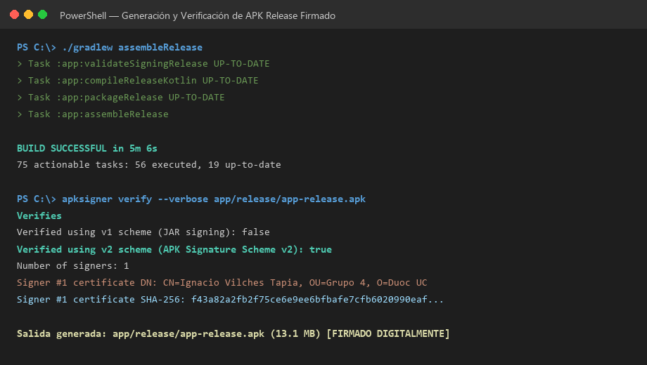
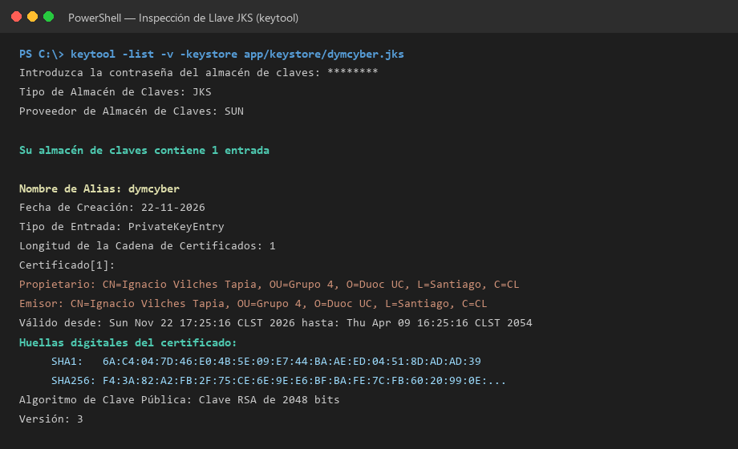
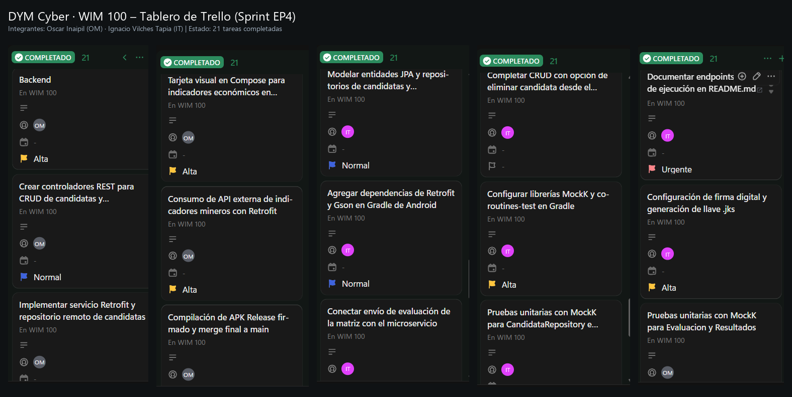

# DYM Cyber · WIM 100 – Aplicación Móvil

**Asignatura:** DSY1105 – Desarrollo de Aplicaciones Móviles  
**Institución:** Duoc UC – Sede San Joaquín  
**Organización / Desafío:** DYM Cyber / Woman and Mining (WIM 100)  
**Evaluación:** Evaluación Parcial 4 – Grupo 4  

---

## 1. Nombre y descripción del proyecto
**DYM Cyber · WIM 100** es una aplicación móvil Android que digitaliza, ordena y centraliza el proceso de postulación y evaluación de candidatas para el reconocimiento **WIM 100** (Woman and Mining).

Permite a las evaluadoras iniciar sesión, registrar y consultar postulantes, revisar sus antecedentes (CV y enlaces a perfiles profesionales simulados), aplicar una matriz homogénea de evaluación con criterios objetivos, justificar las calificaciones con trazabilidad y prevenir evaluaciones duplicadas. Toda la información se persiste directamente en PostgreSQL mediante un microservicio propio en Spring Boot consumido vía Retrofit. Además, la pantalla principal muestra indicadores económicos ligados a la minería obtenidos desde una API externa.

> [!NOTE]
> Todo el sistema opera exclusivamente con **datos ficticios, sintéticos y anonimizados**, cumpliendo con los estándares de privacidad y alcances del caso académico.

---

## 2. Integrantes del equipo
* **Estudiante 1:** Oscar Inaipil
* **Estudiante 2:** Ignacio Vilches Tapia

---

## 3. Funcionalidades
* **Inicio de sesión de evaluadoras** validado contra el microservicio, con contraseñas encriptadas y botón para cerrar sesión.
* **Registro de candidatas** con validación de formulario (nombre, años de experiencia y enlace al perfil profesional).
* **Listado de candidatas** con su estado (Pendiente o Evaluada) y carga de candidatas de prueba.
* **Detalle de candidata** con sus antecedentes, apertura del perfil en el navegador y adjunto de un CV ficticio desde el selector de archivos.
* **Eliminación de candidatas** desde el detalle, con diálogo de confirmación.
* **Matriz de evaluación WIM 100** con cuatro criterios (liderazgo, trayectoria, impacto e innovación) de 1 a 5, cálculo automático del promedio, identificación de la evaluadora y justificación obligatoria.
* **Prevención de evaluaciones duplicadas**: una candidata evaluada no puede volver a evaluarse.
* **Resultados consolidados** con el ranking de candidatas evaluadas y el promedio general.
* **Sincronización con el microservicio**: crear, consultar, actualizar y eliminar candidatas, y enviar cada evaluación al backend en el momento en que se guarda.
* **Indicadores mineros en vivo** (libra de cobre, dólar y UF) desde la API externa mindicador.cl, con opción de reintentar si no hay conexión.

---

## 4. Endpoints utilizados

### Microservicio propio (Spring Boot + PostgreSQL)
URL base desde el emulador: `http://10.0.2.2:8080/api/`  
URL base desde el computador: `http://localhost:8080/api/`

| Método | Endpoint | Descripción |
| :---: | :--- | :--- |
| GET | `/api/candidatas` | Lista todas las candidatas |
| GET | `/api/candidatas/{id}` | Obtiene una candidata por su id |
| POST | `/api/candidatas` | Registra una candidata nueva |
| PUT | `/api/candidatas/{id}` | Actualiza los datos de una candidata (por ejemplo, el CV adjunto) |
| DELETE | `/api/candidatas/{id}` | Elimina una candidata junto con su evaluación |
| GET | `/api/evaluaciones` | Lista las evaluaciones ordenadas por puntaje |
| GET | `/api/evaluaciones/candidata/{candidataId}` | Obtiene la evaluación de una candidata |
| POST | `/api/evaluaciones` | Registra la evaluación de una candidata |
| POST | `/api/auth/login` | Valida el correo y la contraseña de una evaluadora |

### API externa (mindicador.cl)
| Método | Endpoint | Descripción |
| :---: | :--- | :--- |
| GET | `https://mindicador.cl/api` | Indicadores económicos de Chile. La app usa la libra de cobre, el dólar y la UF |

La API externa se consume con un cliente Retrofit independiente (`IndicadoresRetrofitClient`), por lo que no interfiere con los datos locales ni con el microservicio propio.

---

## 5. Arquitectura del proyecto

```text
Moviles_Grupo4/
└── app/                         # Aplicación Android (Kotlin + Jetpack Compose, MVVM)
    ├── keystore/dymcyber.jks    # Llave para firmar el APK
    ├── release/                 # APK release firmado
    └── src/
        ├── main/java/com/example/dymcyber/
        │   ├── model/           # Modelos y DTOs de datos
        │   ├── repository/      # Repositorios y clientes Retrofit
        │   ├── viewmodel/       # Lógica de negocio y estados de cada pantalla
        │   └── screens/         # Pantallas en Jetpack Compose con Material Design 3
        └── test/                # Pruebas unitarias con JUnit, MockK y coroutines-test
```

El microservicio backend en Spring Boot se encuentra en el repositorio separado: [Moviles_Backend_Grupo4](https://github.com/OscarInaipil/Moviles_Backend_Grupo4).

### Tecnologías utilizadas
* **App móvil:** Kotlin, Jetpack Compose con Material Design 3, Navigation Compose, ViewModel con StateFlow.
* **Consumo de APIs:** Retrofit 3 y Gson.
* **Microservicio:** Java 17, Spring Boot 4, Spring Data JPA y PostgreSQL (repositorio independiente).
* **Pruebas unitarias:** JUnit 4, MockK y kotlinx-coroutines-test.
* **Planificación y versiones:** GitHub y Trello.

---

## 6. Pasos para ejecutar

### Requisitos
* Android Studio (versión Ladybug o superior).
* IntelliJ IDEA (para ejecutar el microservicio Spring Boot).
* JDK 17 o superior.
* PostgreSQL corriendo en el puerto `5432`.

### 6.1 Base de datos
Crear la base de datos que usa el microservicio:
```sql
CREATE DATABASE wim100_db;
```
El usuario y la contraseña se configuran en `src/main/resources/application.properties` dentro del repositorio del backend (por defecto `postgres` / `postgres`). Las tablas se crean solas al iniciar el backend.

### 6.2 Microservicio
```bash
git clone https://github.com/OscarInaipil/Moviles_Backend_Grupo4.git
cd Moviles_Backend_Grupo4
mvnw.cmd spring-boot:run
```
También se puede abrir la carpeta `Moviles_Backend_Grupo4` directamente en **IntelliJ IDEA** y ejecutar `WimBackendApplication`. En Linux o macOS se usa `./mvnw spring-boot:run`. El backend queda disponible en `http://localhost:8080` y, la primera vez, carga tres candidatas y dos evaluadoras de prueba.

### 6.3 Aplicación móvil
1. Clonar el repositorio:
   ```bash
   git clone https://github.com/OscarInaipil/Moviles_Grupo4.git
   ```
2. Abrir la carpeta `Moviles_Grupo4` en Android Studio y esperar la sincronización de Gradle.
3. Seleccionar un emulador con API 24 o superior.
4. Presionar **Run 'app'** (`Shift + F10`).

> [!IMPORTANT]
> El emulador se conecta al backend del computador a través de `10.0.2.2`. Para probar en un teléfono físico se debe cambiar `BASE_URL` en `RetrofitClient.kt` por la IP local del computador.

### Usuarios de prueba
| Correo | Contraseña | Código de evaluadora |
| :--- | :--- | :--- |
| `evaluadora1@wim100.cl` | `wim2026` | EVA-01 |
| `evaluadora2@wim100.cl` | `wim2026` | EVA-02 |

Las contraseñas se guardan encriptadas con SHA-256 en la tabla `usuarios`.

### 6.4 Pruebas unitarias
```bash
gradlew test
```
También se pueden ejecutar desde Android Studio con clic derecho sobre `app/src/test/java` → **Run 'Tests in java'**, o con **Run with Coverage** para ver el porcentaje de cobertura.

| Clase de prueba | Qué valida |
| :--- | :--- |
| `CandidataRepositoryTest` | Consulta, registro, actualización y eliminación de candidatas vía Retrofit |
| `CandidataViewModelTest` | Carga de listado, validaciones del registro, adjunto de CV y eliminación |
| `IndicadoresRepositoryTest` | Respuestas correctas, errores y falta de conexión de la API externa |
| `IndicadoresViewModelTest` | Carga de indicadores, mensajes de error y reintento |
| `EvaluacionRepositoryTest` | Envío, consulta por candidata y consolidación de resultados |
| `EvaluacionViewModelTest` | Carga de la candidata, recálculo del promedio y validaciones de la matriz |
| `ResultadosViewModelTest` | Carga desde el servidor y cálculo del promedio general de los resultados |
| `LoginViewModelTest` | Validaciones del login, ingreso correcto, credenciales incorrectas, falta de conexión y cierre de sesión |
| `UsuarioRepositoryTest` | Respuesta del backend al iniciar sesión |

---

## 7. APK firmado y llave .jks
El APK release se firma con la llave `app/keystore/dymcyber.jks`, configurada en el bloque `signingConfigs` de `app/build.gradle.kts`.

| Dato | Valor |
| :--- | :--- |
| Archivo de la llave | `app/keystore/dymcyber.jks` |
| Alias | `dymcyber` |
| Contraseña de la llave y del almacén | `wim100grupo4` |
| APK firmado | `app/release/app-release.apk` |

La llave se generó con `keytool`:
```bash
keytool -genkeypair -keystore dymcyber.jks -storetype JKS -alias dymcyber -keyalg RSA -keysize 2048 -validity 10000
```

Para volver a generar el APK firmado: **Build → Generate Signed App Bundle or APK → APK**, seleccionar la llave `app/keystore/dymcyber.jks` con los datos de la tabla y elegir la variante `release`.

### Capturas
**APK firmado**



**Llave .jks**



---

## 8. Planificación en Trello
Las tareas de la evaluación se distribuyeron entre ambos integrantes en un tablero de Trello.


